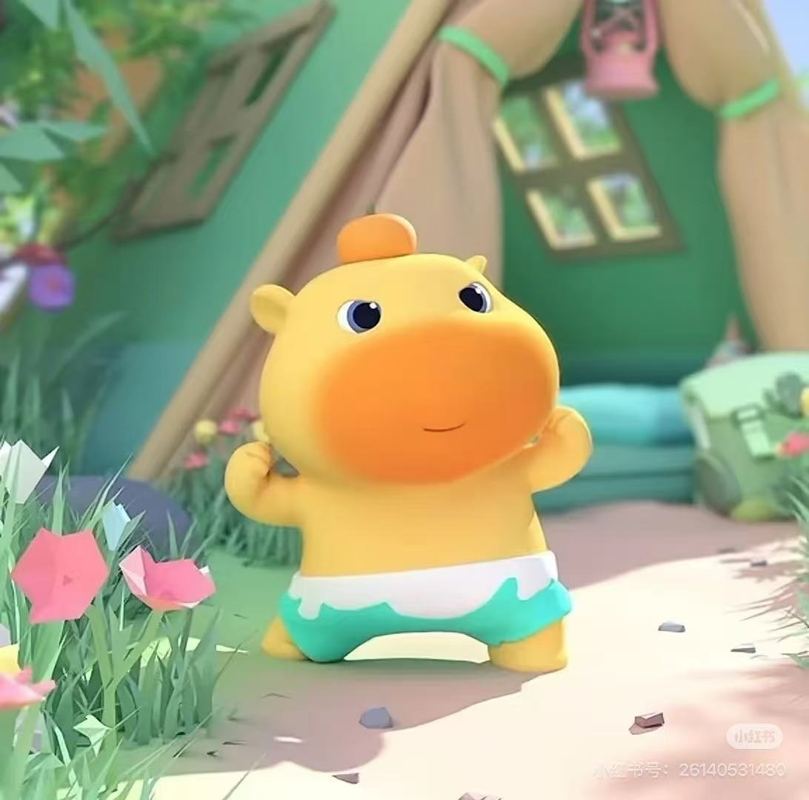

  

<h1 align="center">Hi, I'm Siqi Wang 👋</h1>

  <strong>Year 3 PhD Student in Quantitative Marketing · National University of Singapore</strong>

  Computer Science & Statistics → Data Science & Machine Learning → Quantitative Marketing

  <em>Curious about people. Thoughtful about data. Inspired by Lulu.</em>

## About me

I'm a third-year PhD student in Quantitative Marketing at the National University of Singapore.

With a BSc in Computer Science and Statistics from UBC and an MSc in Data Science and Machine Learning from NUS, I bring a computational and statistical foundation to questions about consumers, advertising, and marketing effectiveness.

My research focuses on multimodal AI for understanding advertising creatives and predicting their effectiveness. I work with audio, visual, text, and human-feedback data to connect what an advertisement contains with how people respond to it.

## What I bring

- **Computing and statistical reasoning.** My training spans computer science, statistics, and machine learning, helping me connect implementation with modelling and evaluation.

- **A marketing perspective on AI.** I connect computational methods with questions about advertising content, consumer responses, and business outcomes.

- **Careful empirical evaluation.** My experience includes supervised and representation learning, nested and out-of-fold cross-validation, randomized consumer experiments, and A/B testing.

- **Experience with business problems.** Through internships at Aibee and Zuoyebang, I worked on advertising performance, conversion funnels, user segmentation, and commercialization strategy.

## Education

| Degree | University | Completion / status |
| --- | --- | --- |
| PhD in Quantitative Marketing | National University of Singapore | Year 3 · 2024–present |
| MSc in Data Science and Machine Learning | National University of Singapore | 2024 |
| BSc in Computer Science and Statistics | University of British Columbia | 2023 |

## Research & selected work

### Multimodal AI for Advertising

Understanding advertising creatives and predicting their effectiveness using audio, visual, text, and human-feedback data.

**Methods:** supervised learning · representation learning · cross-validation · randomized consumer experiments

**Tools used:** Whisper · CLAP · WavLM · htdemucs · GPT-4.1

### Ryde — Dispute Resolution Agents

An ongoing team project connecting evidence, advocacy, and judgement in a ride-dispute workflow. My current work focuses on the Advocate component.

**Focus:** agent workflows · evidence-based arguments · collaboration across modules

### Earlier Projects

- [Air Travel Recovery Prediction](https://github.com/Nicole99uty/Air-travel-recovery-Data-Model-Prediction) — modelling the recovery of China's air travel market during the COVID-19 pandemic.

- [Nicole's Todo List](https://github.com/Nicole99uty/Nicole-s-TODO-LIST) — a todo list written in Java.

## Industry Experience

### Aibee · Data Science Intern

Beijing · May–August 2022

Worked on advertising performance, conversion funnels, and offline A/B testing.

### Zuoyebang · Commercialization Strategy Product Intern

Beijing · January–April 2021

Worked on user segmentation, advertising conversion analysis, and commercialization targeting strategies.

---

  🍊 Thanks for visiting Lulu's little corner.

  <a href="https://github.com/Nicole99uty?tab=repositories">Explore my repositories ↗</a>

